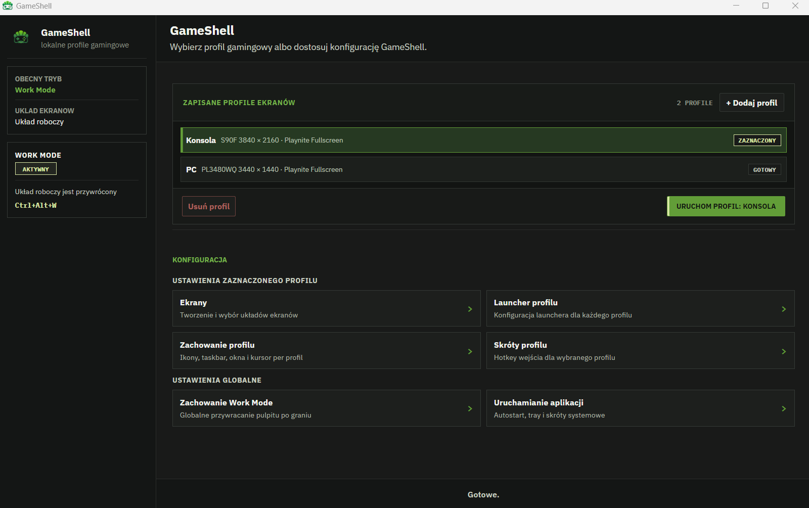

# GameShell

GameShell is a local Windows app for switching the PC between gaming-focused and work-focused desktop modes.

Main runtime/storage paths:

```text
artifacts\installer\GameShell.exe
%LOCALAPPDATA%\GameShell\settings.json
%LOCALAPPDATA%\GameShell\state.json
```

## Core capabilities

- `Console Mode`: activates only the selected console display.
- `PC Gaming`: applies a saved gaming display profile (falls back to Console Mode if not configured).
- `Work Mode`: restores the desktop layout captured before the gaming session.
- Native display control through Windows DisplayConfig APIs (`QueryDisplayConfig`, `SetDisplayConfig`).
- Tray menu + global hotkeys + single-instance command forwarding.
- Per-profile launcher, mode behavior, and shortcut configuration in the UI wizard/dashboard.

## Command-line modes

```powershell
GameShell.exe --gaming
GameShell.exe --pcgaming
GameShell.exe --work
```

When GameShell is already running in tray, a second process forwards the mode command to the existing instance.

## Build

```powershell
.\build.ps1
```

What it does:

- restore .NET solution,
- build React/Vite UI,
- copy UI bundle to `src\GameShell.Desktop\wwwroot`,
- build solution.

## Package

```powershell
.\package.ps1
```

What it does:

- rebuild UI and sync desktop `wwwroot`,
- publish self-contained single-file WPF app,
- write final artifact to `artifacts\installer\GameShell.exe`.

If the destination EXE is locked (running process), script writes a timestamped fallback EXE in `artifacts\installer\`.

## UI/UX status

- Dashboard + profile flow is active after first-run wizard.
- The UI uses the GameShell Green v2 theme with dark neutral surfaces and green accents.
- Motion polish is limited to color, border, opacity, shadow, and small directional cues; it does not change layout or button geometry.
- Work Mode is moved out of quick-switch cards into the sidebar profile module.
- Step `Ekrany` validates profile name and display selection as separate local errors.
- Profile display drafts are committed deterministically before save/navigation.
- The display-profile editor now uses a fixed-height canvas for a stable visual layout, with the topology scaled to fit inside the same viewport while the right-hand properties panel aligns to the same height.
- The profile toolbar and action buttons use a more refined card-like treatment, improving visual cohesion without altering backend or display logic.
- Profile hotkeys are per-profile, normalized to canonical keys, and must remain unique across profiles.
- During hotkey capture (`NASLUCHIWANIE`), registered global hotkeys are temporarily disabled so the UI can validate duplicate combinations locally.
- A duplicate keyboard or controller shortcut remains visible in a red invalid state with its validation message for 2.8 seconds, then the field returns to its previously saved shortcut (or stays empty when there was no previous assignment). Save and dashboard navigation are blocked while the validation error is active.
- The final action in the new-profile flow is labeled `Save changes` and persists the profile before returning to the dashboard.
- `Start with Windows` writes Windows autostart integration, and `Start minimized to tray` now applies on normal app startup.
- Sidebar navigation rows fill their available container width; their chevrons remain vertically centered and move only horizontally on hover.

## Current project status

- GameShell ships as a single bilingual build with English and Polish support, auto-detecting the Windows/system UI culture on first run and preserving the selected interface language in app settings.
- First-run mode initialization is fixed: the dashboard now hydrates the correct runtime mode instead of showing an uninitialized status after setup.
- Settings persistence is now crash-safe and atomic: writes go through `.tmp` + backup recovery and avoid in-place corruption of `settings.json`.
- The Windows session monitor now filters launcher/system processes, requires a short stabilization window before declaring a game active, and logs the real candidate/exit transitions for debug validation.
- Playnite return diagnostics remain intentionally narrow: the code logs the full recovery state and invokes the existing bounded focus restore path only after the lifecycle transition is confirmed in runtime.
- The setup flow and profile editor were tightened up across `WelcomeStep`, `DisplaysStep`, `LauncherStep`, `ConsoleBehaviourStep`, `WorkBehaviourStep`, `AppBehaviourStep`, and `ControllerStep`: validation is local and deterministic, draft display topology is committed before save/navigation, and the profile wizard now follows a consistent navigation and save path.
- Windows startup behavior is now applied on normal app startup as well as fallback scenarios, and profile hotkeys are normalized/validated per profile with duplicate detection kept local to the UI while app hotkeys are temporarily disabled during capture.

## Project layout

```text
src/
  GameShell.Core/
  GameShell.Desktop/
  GameShell.Ui/
  GameShell.Windows/
tests/
  GameShell.Core.Tests/
scripts/
docs/
```

## Current dashboard


