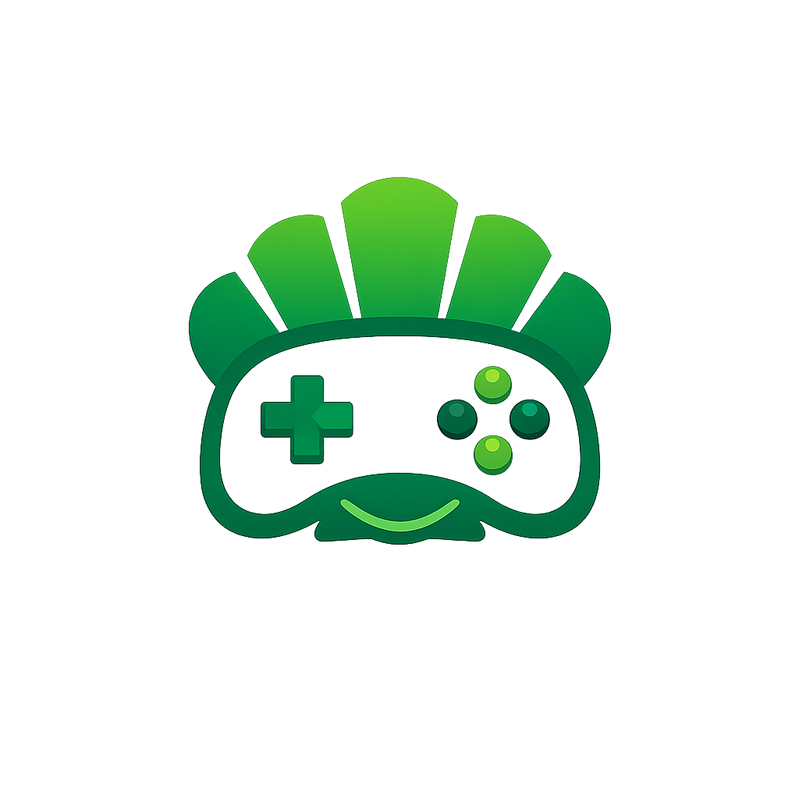
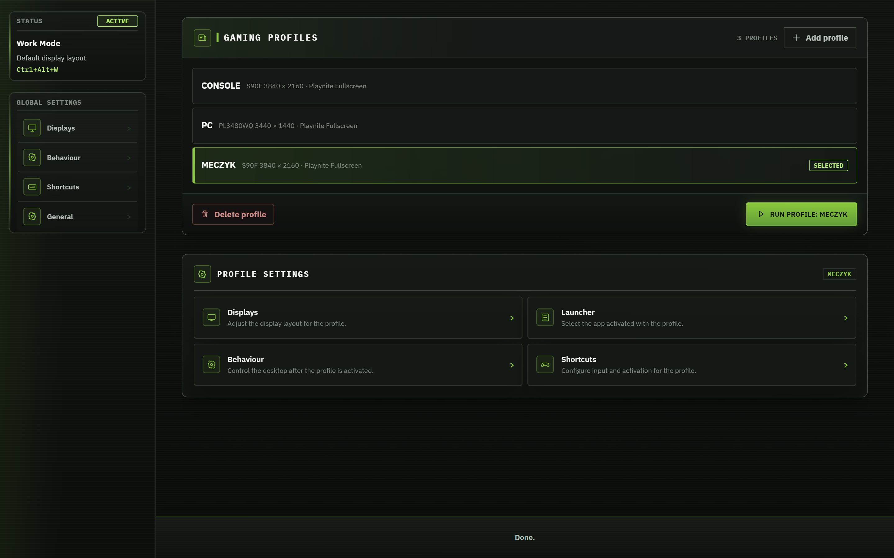
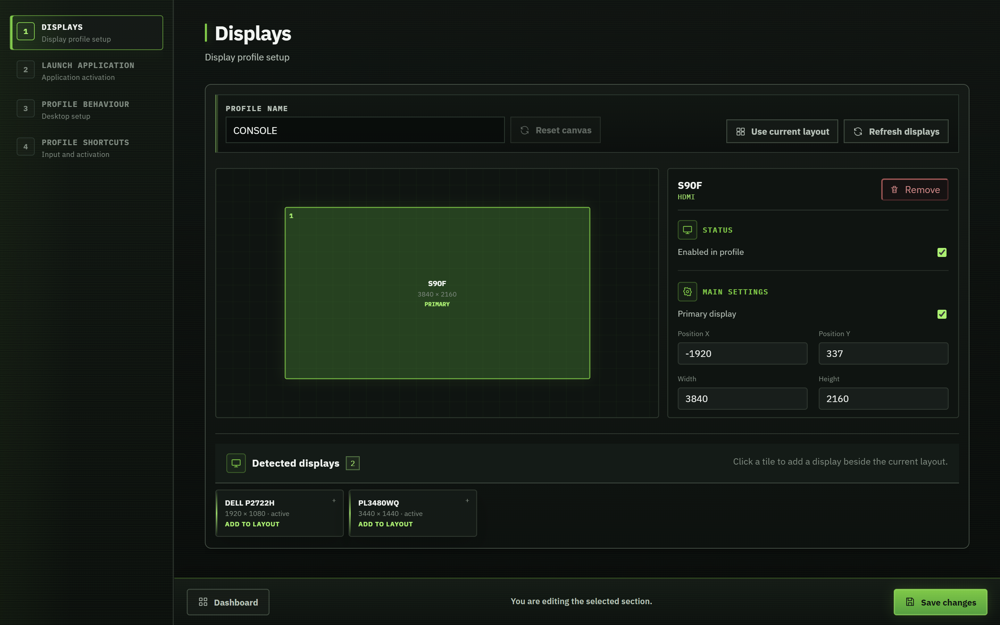
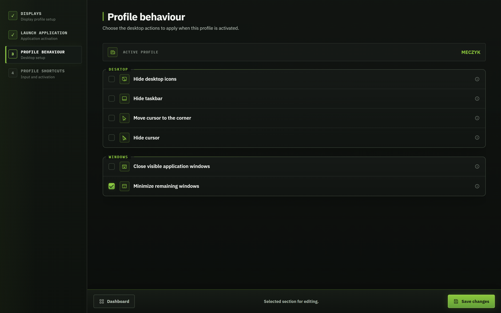
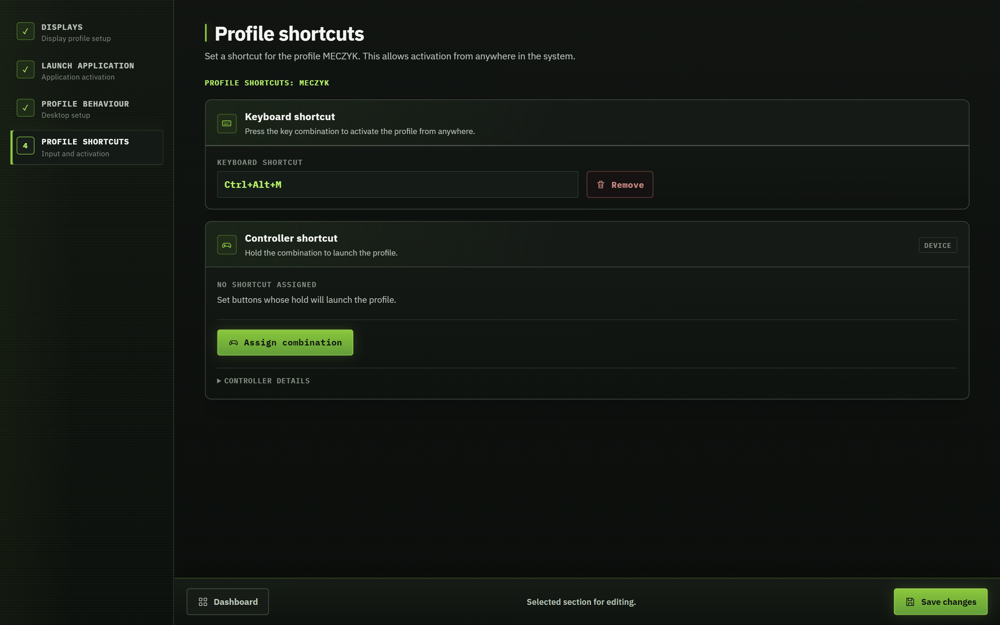

<div align="center">
  <h1> GameShell</h1>
  <p><strong>One PC. Your desk setup. Your gaming setup. One click to switch.</strong></p>
  <p>A Windows desktop app that switches displays, launches your gaming frontend, and prepares the desktop using profiles you control.</p>
  <p>
    <a href="https://github.com/MBllcode/GameShell/actions/workflows/ci.yml"></a>
    
    
  </p>
  <p><a href="#first-launch-setup">First launch</a> · <a href="#see-it-in-action">Screenshots</a> · <a href="#build-and-run">Build & run</a> · <a href="docs/user-guide.md">User guide</a> · <a href="docs/architecture.md">Architecture</a></p>
</div>

[](docs/screenshots/dashboard.png)

Keep a monitor layout for work and another for the TV, projector, or gaming desk. Select a profile and press **Run profile**. Return through **Work Mode** when you are done.

## First launch setup

On a fresh PC, when no `settings.json` exists yet, GameShell creates its local settings and opens a guided setup wizard. This is the app's initial configuration, not a separate installer — you do not need to create or edit the JSON file yourself.

1. **Choose your language** — English or Polish.
2. **Create your first gaming profile** — displays, launcher, desktop behaviour, and keyboard/controller shortcuts.
3. **Set up Work Mode** — the display layout, desktop behaviour, and shortcuts used when returning to work.
4. **Choose startup options, review, and save** — including automatic startup and desktop/Start-menu shortcuts.

Completing the wizard opens the dashboard. Later launches go straight to it; unfinished setup appears again until completed. Your configuration is stored in `%LOCALAPPDATA%\GameShell\settings.json`. [Step-by-step guide →](docs/user-guide.md#first-launch-setup)

## See it in action

Click a screenshot to view its full-resolution, lossless PNG.

### 1. Choose your displays

Name a profile, add detected displays, and drag them into position. Select a screen to set its resolution, primary status, and refresh rate.

[](docs/screenshots/displays.png)

### 2. Decide what changes

Choose whether to hide desktop icons or the taskbar, move the cursor, minimize windows, or start a launcher. Each profile keeps its own choices. A profile can also change displays only.

[](docs/screenshots/behaviour.png)

### 3. Switch without opening the app

Assign a keyboard shortcut or controller combination to a profile. Set a separate **Work Mode** shortcut to return to your desk. The tray menu also provides profile activation and Work Mode.

[](docs/screenshots/shortcuts.png)

**Launchers:** Playnite Fullscreen, Steam Big Picture, and Xbox App. Xbox opens in its normal windowed mode.

After setup, use **Profile settings** to edit a gaming profile and **Global settings** to change Work Mode or startup options. [Full setup guide →](docs/user-guide.md)

## Build and run

You need **Windows x64**, the **.NET 9 SDK**, **Node.js 22.6+ with npm**, and the **Microsoft Edge WebView2 Runtime**. A packaged build includes .NET; WebView2 and your chosen launcher are separate prerequisites.

```powershell
git clone https://github.com/MBllcode/GameShell.git
cd GameShell
.\scripts\build.ps1
.\src\GameShell.Desktop\bin\Debug\net9.0-windows\GameShell.exe
```

Create a portable, self-contained EXE:

```powershell
.\scripts\package.ps1
# Output: artifacts\installer\GameShell.exe
```

Packaging closes any running GameShell instance and launches the new build. Use `-NoLaunch` to build without launching it. Keep the packaged EXE in a stable location before enabling **Start with Windows**.

## Inside the project

| Layer | Responsibility |
| --- | --- |
| `GameShell.Ui` | React 19 + TypeScript interface, profile editor, EN/PL translations |
| `GameShell.Desktop` | WPF + WebView2 host, tray, global shortcuts, optional LAN API |
| `GameShell.Core` | Profile transitions, session state, validation, settings persistence |
| `GameShell.Windows` | Native display configuration, process launching, window and cursor control |

The app uses Windows DisplayConfig APIs directly. It waits for display discovery to settle before starting a launcher, keeps settings and runtime state separate, and routes UI, tray, shortcut, and API commands through the same transition pipeline.

```powershell
dotnet test tests\GameShell.Core.Tests\GameShell.Core.Tests.csproj
npm --prefix src/GameShell.Ui test
```

[Documentation](docs/README.md) · [Architecture](docs/architecture.md) · [Development & verification](docs/development.md) · [Changelog](docs/CHANGELOG.md)

GameShell is a personal project under active development. Display switching depends on the modes Windows and the connected hardware expose; cold boot, hotplug, and launcher behaviour need testing on the target PC. Screenshots show the running application with an example local configuration.
