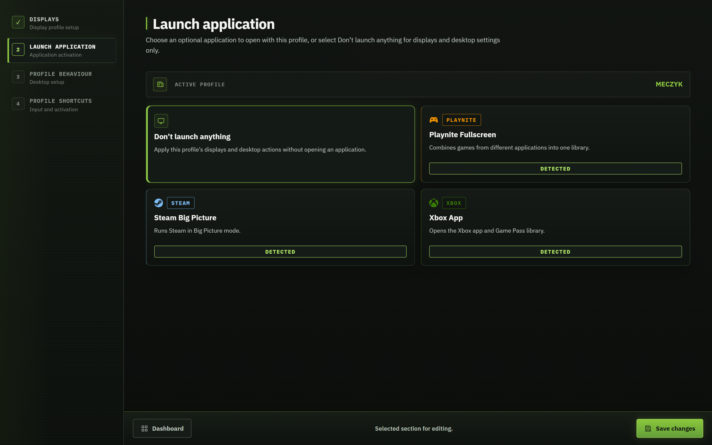

  <h1><picture><source media="(prefers-color-scheme: dark)" srcset="docs/assets/wordmark-dark.svg"></picture></h1>
  
<strong>One PC. Your desk. Your TV. Your profiles. One click to switch.</strong>

  
Switch displays, optionally launch an application, and prepare your desktop with profiles you control.

  

    <a href="https://github.com/MBllcode/GameShell/releases/latest/download/GameShell.exe"><strong>Download GameShell.exe</strong></a> ·
    <a href="https://github.com/MBllcode/GameShell/releases/latest/download/GameShell-win-x64.zip">Download ZIP</a> ·
    <a href="https://github.com/MBllcode/GameShell/releases">All releases</a>
  

  

    
    
    
  

  
<a href="#download-and-run">Get started</a> · <a href="#first-launch-setup">First launch</a> · <a href="#see-it-in-action">Screenshots</a> · <a href="docs/user-guide.md">User guide</a>

Keep profiles for your desk, TV, projector, or gaming setup. Profiles can share the same displays and use different applications. Press **Run profile** to switch, then **Restore default setup** to return.

## Download and run

1. Download [GameShell.exe](https://github.com/MBllcode/GameShell/releases/latest/download/GameShell.exe), or extract the [ZIP](https://github.com/MBllcode/GameShell/releases/latest/download/GameShell-win-x64.zip).
2. Put the EXE in a permanent folder and open it. Keep this location when enabling **Start with Windows**.
3. Complete the first-launch setup below.

Requires **Windows x64** and the [Microsoft Edge WebView2 Runtime](https://developer.microsoft.com/microsoft-edge/webview2/). The download includes .NET; you do not need Node.js, a .NET SDK, or build scripts. Applications such as Playnite are needed only by profiles that launch them.

## First launch setup

When no `settings.json` exists, GameShell creates its local settings and opens a guided wizard:

1. Choose **English or Polish**.
2. Save your **default setup**: displays, desktop restoration actions, and optional shortcuts.
3. Optionally create your first **profile**. Choose **Create a profile later** to skip it.
4. Review startup options and finish setup.

Later launches open the dashboard; unfinished setup resumes until completed. Settings live in `%LOCALAPPDATA%\GameShell\settings.json`. [Full walkthrough →](docs/user-guide.md#first-launch-setup)

## See it in action

Screenshots below are fresh, lossless captures of the running app. Click to view full resolution.

### 1. Choose your displays

Add detected screens, drag them into position, and set the primary display, resolution, and refresh policy.

### 2. Choose an application — or none

The **Application** page offers **Don't launch anything**, Playnite Fullscreen, Steam Big Picture, and Xbox App. A TV profile can switch displays without opening a launcher; another profile can use that same TV with an application.

### 3. Decide what happens to the desktop

Choose whether to hide desktop icons or the taskbar, move the cursor, or close and minimize windows. Selected applications are brought to the foreground automatically.

### 4. Switch with a shortcut

Assign keyboard shortcuts or controller combinations to profiles and a separate shortcut to restore your default setup. The tray menu provides the same actions.

## Inside the project

| Project | Responsibility |
| --- | --- |
| `GameShell.Ui` | React + TypeScript editor, first-launch setup, EN/PL translations |
| `GameShell.Desktop` | WPF + WebView2 host, tray, shortcuts, optional LAN API |
| `GameShell.Core` | Profiles, transitions, validation, settings and runtime state |
| `GameShell.Windows` | Native displays, application processes, windows and cursor control |

See [Architecture](docs/architecture.md) for the profile activation pipeline and project boundaries. [Development](docs/development.md) covers building, tests, packaging and releases.

[User guide](docs/user-guide.md) · [Architecture](docs/architecture.md) · [Remote Control](docs/remote-control.md) · [Changelog](docs/CHANGELOG.md)

GameShell is under active development. Display modes depend on Windows and connected hardware. Screenshots show real configured profiles; their names are user-defined.
