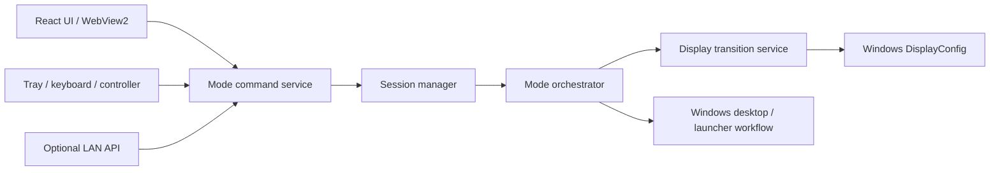

# Architecture

[← Back to README](../README.md)

GameShell separates desktop presentation, mode/session decisions, and Windows side effects. The UI describes the desired profile; native services apply it.

## Project boundaries

| Project | Main responsibilities | Depends on |
| --- | --- | --- |
| `GameShell.Core` | Models, state machines, validation, settings, transitions, service interfaces | Logging abstractions |
| `GameShell.Windows` | DisplayConfig interop, mode enumeration, process/session monitoring, window/cursor operations | Core |
| `GameShell.Desktop` | WPF lifecycle, dependency injection, WebView bridge, tray, hotkeys, SDL controller input, HTTP host | Core, Windows |
| `GameShell.Ui` | React profile/setup flows, form drafts, layout preview, localization | Typed WebView message contract |

`tests/GameShell.Core.Tests` contains xUnit tests across the core, Windows mapping/geometry, and desktop routing/security boundaries. UI tests use Node's built-in test runner for routing, display identity/topology, shortcuts, localization, and status mapping.

## A profile transition

1. UI, tray, shortcut, or API resolves a command through `IModeCommandService`.
2. The session manager serializes lifecycle work and resolves the profile's own launcher, behaviour, and shortcuts.
3. Display discovery waits for stable inventory. The transition service applies the requested topology and verifies it.
4. The Windows workflow performs enabled desktop/cursor/window actions and starts the selected application, if any.
5. `ProfileApplicationPolicy` enables game monitoring only for supported applications with launch enabled. Display-only profiles stay `ProfileActive` without monitoring or recovery. Default setup runs the restoration path; transition failures can use the captured rollback layout.

Startup resolves one target from startup preferences and committed runtime state. Default setup reconciliation also restores desktop behaviour when the display topology already matches; matching monitors alone does not imply that the taskbar, cursor, or launcher state is correct.

## Display identity

Known physical displays are stored separately from transient Windows observations and profile-local settings. A route, adapter identifier, friendly name, or mode-list change does not by itself mean a new physical monitor.

Historical capability data is diagnostic. `AutoHighest` uses the active modes currently exposed by Windows after activation. `Fixed` remains strict. Normal transitions do not reset GPUs, monitor devices, HDMI inputs, or TV power.

## Persistence and state

- `%LOCALAPPDATA%\GameShell\settings.json` stores configuration. Callers receive independent snapshots; the cache is published only after a successful atomic save. A backup supports recovery.
- `state.json` stores committed runtime targets and return/previous layouts. Writes are serialized and use temporary-file replacement plus backup fallback.
- Backend-owned transient operation state drives the bottom status line. Transition IDs prevent an older completion from clearing newer work.
- Session generations reject late game/process callbacks from an earlier session.

## Host and UI

The manifest declares PerMonitorV2 before any WPF, tray, or WebView HWND is created. Saved window placement is checked against active monitor work areas after topology changes.

The footer has a dedicated layout row. `ViewportContent` measures the remaining page region and fits content when necessary, keeping the whole page visible without a window scrollbar. Display-canvas drag coordinates account for the resulting scale; the display inspector retains its own bounded scroll region.

The WebView bridge accepts privileged messages only from `https://app.gameshell.local` on the default HTTPS port, blocks navigation to other origins, and suppresses popup windows. `about:blank` is allowed only for the missing-assets page and is not a trusted command origin.

## Native and remote boundaries

Launcher process creation uses a shared Windows adapter. Optional Remote Control is disabled by default, accepts predefined commands, checks a bearer token, and defaults to private/local source addresses. It shares the normal mode-command pipeline rather than changing displays directly. See [Remote Control](remote-control.md).

Builds and automated tests exercise logic and contracts. Real display-driver behaviour, DPI changes at sign-in, hotplug, game detection, and launcher focus still require Windows hardware testing.

## Finding your way through the code

The two active states are **Default setup** and **a selected profile**. Console/PC are not profile types. A profile owns its display layout, optional application, desktop actions, and shortcuts; identical display layouts are allowed.

| To understand or change… | Start here |
| --- | --- |
| Application choices and whether games are monitored | `src/GameShell.Core/Profiles/ProfileApplicationPolicy.cs` |
| Which profile settings a command uses | `src/GameShell.Core/Profiles/ProfileSettingsResolver.cs` |
| Activation, reactivation, and late game callbacks | `src/GameShell.Core/Profiles/ProfileSessionManager.cs` |
| Display/workflow order, rollback, and runtime commits | `src/GameShell.Core/Runtime/ModeOrchestrator.cs` |
| Profile creation and layout persistence | `src/GameShell.Desktop/Bridge/WebViewDisplayCommandHandler.cs` |
| Form state → settings payload | `src/GameShell.Ui/src/features/settings/buildSettingsPayload.ts` |
| First-run/profile/edit navigation | `src/GameShell.Ui/src/features/setup/setupFlow.ts` and its hooks |

[Read the code tour](code-tour.md) for an ordered walkthrough and a map of the feature folders.

Follow a command from the bridge through the session manager and orchestrator before looking into native Windows adapters. Tests next to these responsibilities cover the policy independently of hardware.

### Compatibility boundary

Persisted fields such as `gamingProfiles`, `gaming`, and `workMode`, plus older command aliases, retain their names so existing settings and integrations keep loading. The historical `Console` runtime enum value is reserved for deserialization; it is normalized to the profile state and never emitted by activation. Old Console startup requests resolve an existing selected profile or fall back to the default setup. There is one activation pipeline.

`launcher.type = "None"` is explicit. It clears launch arguments/path and disables launch/foreground flags. Existing profiles with `startLauncher = false` hydrate as no application, preserving their behaviour. Changing the application updates the launch flag; the UI no longer exposes a second competing start checkbox.

## Source organization

Core groups contracts and implementations under `Profiles`, `Displays`, `Runtime`, `Settings`, `Applications`, and `Shortcuts`. Windows adapters are grouped under `Displays`, `Desktop`, and `Applications`. Desktop owns `Hosting`, `Bridge`, `Tray`, `Shortcuts`, `Windowing`, `Displays`, and `RemoteControl`.

The React entry point is `src/GameShell.Ui/src/app/App.tsx`. Feature components live beside their actions and data helpers. Shared primitives live in `shared/ui`; WebView transport and DTOs live together in `bridge`.

`features/profiles/profileModel.ts` defines one editable profile record. Behaviour/application/shortcut maps are derived views, not independently stored state. `profilesFromSettings` handles historical configuration shapes, while `buildSettingsPayload` projects records back to the compatible JSON contract. Backend persisted settings remain versioned DTOs; native observed display snapshots remain distinct from requested profile topologies.

The monitor catalogue facade delegates identity matching, capability policy, projection, and reconciliation to small modules under `Displays/Catalog`. Its public operations remain the entry point for discovery and validation.

Styles enter through `styles.css`, which imports named modules in a fixed cascade order. Edit the relevant component/theme/geometry module instead of appending another global override. TypeScript rejects unused locals and parameters during the standard build.
