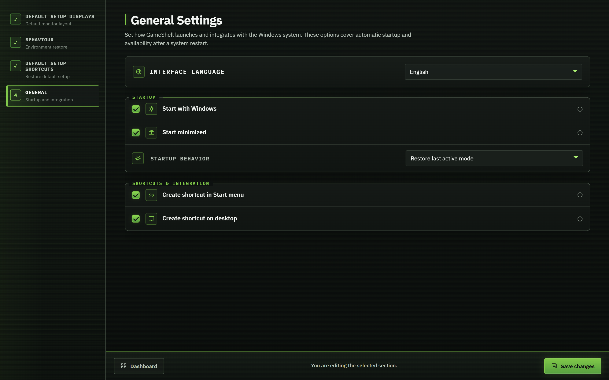

# Using GameShell

[← Back to README](../README.md)

## Download and updates

Download [GameShell.exe](https://github.com/MBllcode/GameShell/releases/latest/download/GameShell.exe) or the [ZIP](https://github.com/MBllcode/GameShell/releases/latest/download/GameShell-win-x64.zip) from GitHub Releases. Extract the ZIP if needed, keep the EXE in a permanent folder, and launch it. The package includes .NET; the [WebView2 Runtime](https://developer.microsoft.com/microsoft-edge/webview2/) is required separately.

To update, exit GameShell from the tray and replace the EXE in the same folder with the newer download. Keep `%LOCALAPPDATA%\GameShell` to retain your settings. Each release also provides `SHA256SUMS.txt` for its EXE and ZIP.

## First launch setup

On a fresh installation, GameShell has no saved settings. Launch `GameShell.exe` to create `%LOCALAPPDATA%\GameShell\settings.json` and start the first-run wizard automatically. No separate installation wizard or manual JSON editing is needed.

Follow the sidebar steps in order:

1. **Welcome:** choose English or Polish.
2. **Default setup:** save at least one active display, choose desktop restoration actions, and assign optional restoration shortcuts.
3. **Profile (optional):** name a profile, arrange its displays, select an optional application and desktop actions, and assign shortcuts. Choose **Create a profile later** to skip this part.
4. **General:** choose Windows startup behaviour and optional desktop/Start-menu shortcuts.
5. **Summary:** review the configuration and finish setup to open the dashboard.

GameShell creates the settings file before setup finishes. The completion flag, rather than the file's presence alone, determines whether the next launch shows the wizard or the dashboard. Closing the app before completing setup leaves first-run configuration incomplete.

After completing setup, all these options remain editable from the dashboard. The sections below describe those later edits.

## Your default setup

Open **Global settings → Displays**. Arrange the monitors as you want them for work, choose **Use current layout**, then **Save changes**. This is the default layout GameShell can restore when returning to Default setup.

**Global settings → Behaviour** controls what returning to work does: close the launcher, show taskbars and desktop icons, and restore minimized windows. **Global settings → Shortcuts** assigns your Default setup keyboard/controller shortcut.

## Create a profile

1. On the dashboard, choose **Add profile** and give it a name, such as `Living room`.
2. In **Displays**, click detected display tiles to add them. Drag the preview tiles to arrange them. Select a tile to edit its primary status, position, resolution, and refresh policy.
3. In **Launch application**, keep **Don’t launch anything** for a display-only profile, or choose Playnite Fullscreen, Steam Big Picture, or Xbox App. A selected application must be installed separately.
4. In **Profile behaviour**, enable the desktop changes you want. **Bring application to the foreground** is available when an application is selected. New profiles start with desktop actions disabled.
5. In **Profile shortcuts**, assign a keyboard or controller combination if desired. Choose **Save changes**.

**Refresh displays** reloads Windows inventory. **Use current layout** replaces the draft with the current Windows arrangement. **Reset canvas** restores the profile's saved draft layout (or an empty layout for a new profile); it is not a Windows display reset. Changes take effect when you run the profile, not merely when you edit its preview.

For example, `Football` can use the TV without an application, while `Playnite` and `Steam` profiles can use the same TV with different applications. Profile names have no special meaning or rules.

## Run a profile and return to work

Select a profile on the dashboard and click **Run profile**. You can also use its assigned shortcut or the tray menu. GameShell applies the display configuration and enabled desktop/launcher actions.

Return with your Default setup shortcut or **Restore default setup** in the tray menu. Closing the main window normally leaves GameShell running in the tray; choose **Close GameShell** there to exit completely.

Profiles remain active until you choose another profile or restore the default setup. Profiles without an application do not start game monitoring or launcher recovery. With a supported application enabled, game-session monitoring can return focus to that application after a game exits.

## Startup and language

**Global settings → General** contains:

- **Interface language:** English or Polish.
- **Start with Windows** and **Start minimized**.
- **Startup behaviour:** always Default setup, restore the last active mode, or start a selected profile.
- Start-menu and desktop shortcuts.

GameShell runs as a normal Windows application with Explorer. The former Explorer replacement / Console Shell feature has been removed. Names such as `Console` or `PC` are ordinary user-created profile names, not built-in modes.

## Display refresh rates

**Highest available** uses the modes Windows reports after activating the target display. **Fixed** requires the selected mode to be available. A TV advertising only 60 Hz cannot be forced to 144 Hz by a saved profile; check its input mode, cable, and Windows display settings.

## Troubleshooting

| Problem | Where to look |
| --- | --- |
| A screen is missing | Reconnect it, wait for Windows to detect it, then choose **Refresh displays**. |
| A profile changes displays but does not start a launcher | Check **Launch application** and whether the selected application is installed. |
| A shortcut is rejected | Choose a combination not already assigned to another profile or Default setup. |
| The window is off-screen after a display change | Open GameShell from the tray; saved placement is checked against active monitors. |
| Unexpected startup target | Review **General → Startup behaviour**. `GameShell.exe --safe-mode` on a fresh process requests Default setup and opens the UI. |

Settings, runtime state, and logs live in `%LOCALAPPDATA%\GameShell`. Before sharing logs or settings, remove personal paths and the Remote Control authentication token.
