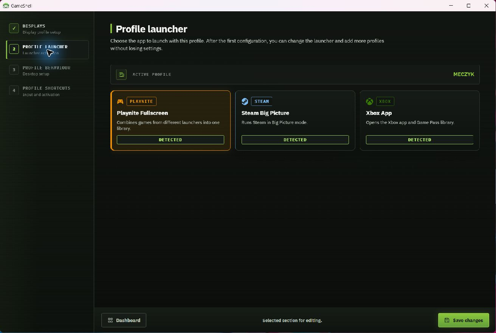
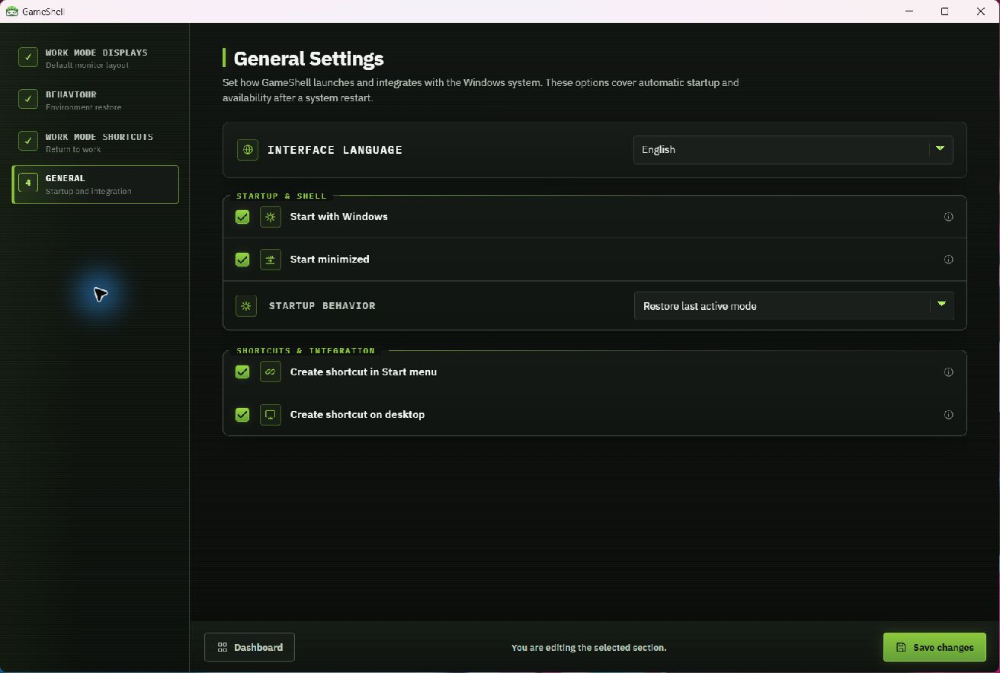

# Using GameShell

[← Back to README](../README.md)

## Save your work setup first

Open **Global settings → Displays**. Arrange the monitors as you want them for work, choose **Use current layout**, then **Save changes**. This is the default layout GameShell can restore when returning to Work Mode.

**Global settings → Behaviour** controls what returning to work does: close the launcher, show taskbars and desktop icons, and restore minimized windows. **Global settings → Shortcuts** assigns your Work Mode keyboard/controller shortcut.

## Create a gaming profile

1. On the dashboard, choose **Add profile** and give it a name, such as `Living room`.
2. In **Displays**, click detected display tiles to add them. Drag the preview tiles to arrange them. Select a tile to edit its primary status, position, resolution, and refresh policy.
3. In **Launcher**, select Playnite Fullscreen, Steam Big Picture, or Xbox App. The launcher must be installed separately.
4. In **Profile behaviour**, enable the desktop changes you want. Enable **Start launcher** if the profile should launch the selected app; leave it disabled for a display-only setup.
5. In **Profile shortcuts**, assign a keyboard or controller combination if desired. Choose **Save changes**.

**Refresh displays** reloads Windows inventory. **Use current layout** replaces the draft with the current Windows arrangement. **Reset canvas** restores the profile's saved draft layout (or an empty layout for a new profile); it is not a Windows display reset. Changes take effect when you run the profile, not merely when you edit its preview.

## Run a profile and return to work

Select a profile on the dashboard and click **Run profile**. You can also use its assigned shortcut or the tray menu. GameShell applies the display configuration and enabled desktop/launcher actions.

Return with your Work Mode shortcut or **Return to Work Mode** in the tray menu. Closing the main window normally leaves GameShell running in the tray; choose **Close GameShell** there to exit completely.

When a supported game session ends, GameShell can return focus to its launcher. To finish the gaming session and return to your desk, request Work Mode.

## Startup and language

**Global settings → General** contains:

- **Interface language:** English or Polish.
- **Start with Windows** and **Start minimized**.
- **Startup behaviour:** always Work Mode, restore the last active mode, or start a selected profile.
- Start-menu and desktop shortcuts.

GameShell runs as a normal Windows application with Explorer. The former Explorer replacement / Console Shell feature has been removed. A profile named `CONSOLE` in the screenshots is just a user-created gaming profile.

## Display refresh rates

**Highest available** uses the modes Windows reports after activating the target display. **Fixed** requires the selected mode to be available. A TV advertising only 60 Hz cannot be forced to 144 Hz by a saved profile; check its input mode, cable, and Windows display settings.

## Troubleshooting

| Problem | Where to look |
| --- | --- |
| A screen is missing | Reconnect it, wait for Windows to detect it, then choose **Refresh displays**. |
| A profile changes displays but does not start a launcher | Check **Profile behaviour → Start launcher** and whether the selected launcher is installed. |
| A shortcut is rejected | Choose a combination not already assigned to another profile or Work Mode. |
| The window is off-screen after a display change | Open GameShell from the tray; saved placement is checked against active monitors. |
| Unexpected startup target | Review **General → Startup behaviour**. `GameShell.exe --safe-mode` on a fresh process requests Work Mode and opens the UI. |

Settings, runtime state, and logs live in `%LOCALAPPDATA%\GameShell`. Before sharing logs or settings, remove personal paths and the Remote Control authentication token.
