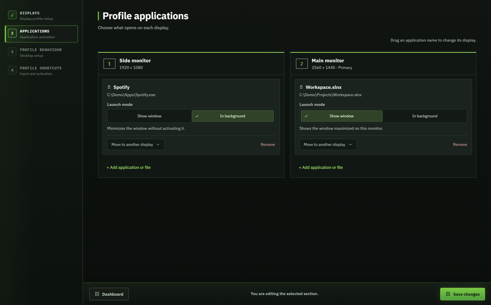
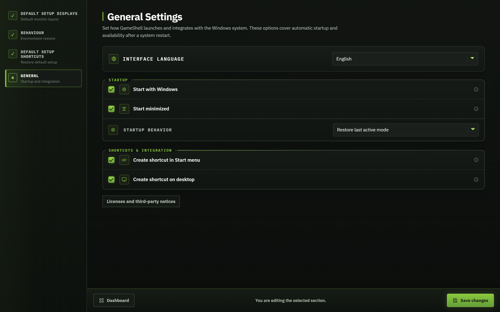

# Using GameShell

[← Back to README](../README.md)

## Download and updates

Download [GameShell.exe](https://github.com/MBllcode/GameShell/releases/latest/download/GameShell.exe) or the [ZIP](https://github.com/MBllcode/GameShell/releases/latest/download/GameShell-win-x64.zip) from GitHub Releases. Extract the ZIP if needed (it includes the EXE and license texts), keep the EXE in a permanent folder, and launch it. The package includes .NET; the [WebView2 Runtime](https://developer.microsoft.com/microsoft-edge/webview2/) is required separately.

To update, exit GameShell from the tray and replace the EXE in the same folder with the newer download. Keep `%LOCALAPPDATA%\GameShell` to retain your settings.

## First launch setup

On a fresh installation, GameShell has no saved settings. Launch `GameShell.exe` to create `%LOCALAPPDATA%\GameShell\settings.json` and start the first-run wizard automatically. No separate installation wizard or manual JSON editing is needed.

Follow the sidebar steps in order:

1. **Welcome:** choose English or Polish.
2. **Default setup:** save at least one active display, choose desktop restoration actions, and assign optional restoration shortcuts.
3. **Profile (optional):** name a profile, arrange its displays, assign apps or files, choose desktop actions, and assign shortcuts. Choose **Create a profile later** to skip this part.
4. **General:** choose Windows startup behaviour and optional desktop/Start-menu shortcuts.
5. **Summary:** review the configuration and finish setup to open the dashboard.

The first-run wizard configures one optional profile. Choosing **Next** from its Displays step prepares a provisional profile. If **Back** returns you to that step, GameShell discards that profile and clears its name, displays, application, desktop actions and shortcuts. **Create a profile later** is available again. Your default setup stays intact. After skipping the profile, **Back** from General returns directly to the optional profile step. Add further profiles from the dashboard after finishing setup.

GameShell creates the settings file before setup finishes. The completion flag, rather than the file's presence alone, determines whether the next launch shows the wizard or the dashboard. Closing the app before completing setup leaves first-run configuration incomplete.

After completing setup, all these options remain editable from the dashboard. The sections below describe those later edits.

## Your default setup

Open **Global settings → Displays**. Arrange the monitors as you want them for work, choose **Use current layout**, then **Save changes**. This is the default layout GameShell can restore when returning to Default setup.

In **Global settings → Behaviour**, choose whether returning to work shows taskbars and desktop icons, restores minimized windows, and requests that apps started by the profile session close. **Close profile applications** uses a normal window close so apps can show a save prompt. Apps that were already open, shared document editors, and launchers whose process GameShell cannot verify may stay open. Use **Global settings → Shortcuts** to assign a keyboard or controller shortcut to restore Default setup.

## Create a profile

1. On the dashboard, choose **Add profile** and give it a name, such as `Living room`.
2. In **Displays**, click detected display tiles to add them. Drag the preview tiles to arrange them. Select a tile to edit its primary status, position, resolution, and refresh policy.
3. In **Profile applications**, use **Add application or file** under the display where you want it to open. Leave the lists empty for a display-only profile.
4. In **Profile behaviour**, enable the desktop changes you want. New profiles start with desktop actions disabled.
5. In **Profile shortcuts**, assign a keyboard or controller combination if desired. Choose **Save changes**.

**Refresh displays** reloads Windows inventory. **Use current layout** replaces the draft with the current Windows arrangement. **Reset canvas** restores the profile's saved draft layout (or an empty layout for a new profile); it is not a Windows display reset. Changes take effect when you run the profile, not merely when you edit its preview.

For example, `Football` can use the TV on its own, while `Desk` and `Editing` can share the same monitors with different apps and files.

### Assign apps and files to displays

Search by name, paste a full path, or open the Windows file picker. Search covers common file types on ready drives. Documents open in the app associated with their file type in Windows.

- **Show window** opens a maximized window on the assigned display. **In background** minimizes the window without activating it.
- Drag an app name onto another display or use **Move to another display**. Each entry keeps its full path and launch mode.
- App assignments from existing profiles follow the display when GameShell reconciles two saved identities for the same screen. If a display is unavailable, the app stays saved and can be reassigned in **Profile applications**.
- Profiles from older versions can still show their saved legacy launcher. Remove it there if you want to use only the per-display app list.

## Run a profile and return to work

Select a profile on the dashboard and click **Run profile**. You can also use its assigned shortcut or the tray menu. GameShell applies the display configuration and enabled desktop/launcher actions.

Return with your Default setup shortcut or **Restore default setup** in the tray menu. Closing the main window normally leaves GameShell running in the tray, where saved keyboard and controller shortcuts still work. Choose **Close GameShell** in the tray to exit completely.

Profiles remain active until you choose another profile or restore the default setup. Profiles without an application do not start game monitoring or launcher recovery. With a supported application enabled, game-session monitoring can return focus to that application after a game exits.

## Startup and language

**Global settings → General** contains:

- **Interface language:** English or Polish.
- **Start with Windows** and **Start minimized**.
- **Startup behaviour:** always Default setup, restore the last active mode, or start a selected profile.
- Start-menu and desktop shortcuts.

GameShell runs as a normal Windows application with Explorer. The former Explorer replacement / Console Shell feature has been removed. Names such as `Console` or `PC` are ordinary user-created profile names, not built-in modes.

The **Licenses and third-party notices** button in General opens the included notices offline. Press **Close** or **Escape** to return to settings.

## Display refresh rates

**Highest available** uses the modes Windows reports after activating the target display. **Fixed** requires the selected mode to be available. A TV advertising only 60 Hz cannot be forced to 144 Hz by a saved profile; check its input mode, cable, and Windows display settings.

When Windows reports the same supported HDMI display under different identities, GameShell can combine the entries and keep its model name. For inactive screens, it can use a known preferred or remembered resolution. If no valid resolution is known, turn on the screen and choose **Refresh displays** before adding it.

## Troubleshooting

| Problem | Where to look |
| --- | --- |
| A screen is missing | Reconnect it, wait for Windows to detect it, then choose **Refresh displays**. |
| An app or file does not open | Check its path and assigned monitor in **Profile applications**. For documents, check that Windows has a default app for the file type. |
| A shortcut is rejected | Choose a combination not already assigned to another profile or Default setup. |
| The window is off-screen after a display change | Open GameShell from the tray; saved placement is checked against active monitors. |
| Unexpected startup target | Review **General → Startup behaviour**. `GameShell.exe --safe-mode` on a fresh process requests Default setup and opens the UI. |

Settings, runtime state, and logs live in `%LOCALAPPDATA%\GameShell`. Before sharing logs or settings, remove personal paths and the Remote Control authentication token.
